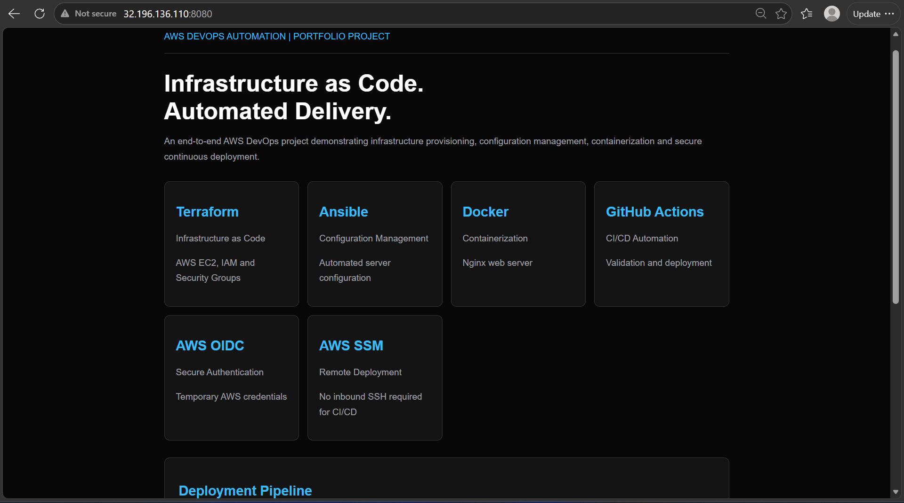
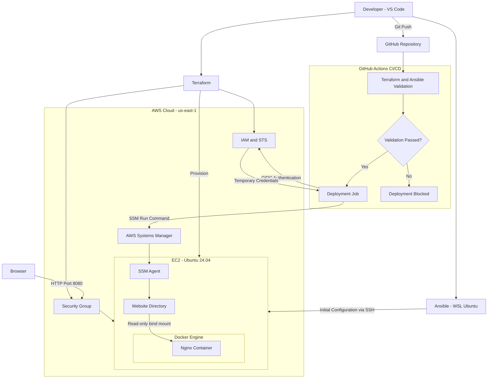
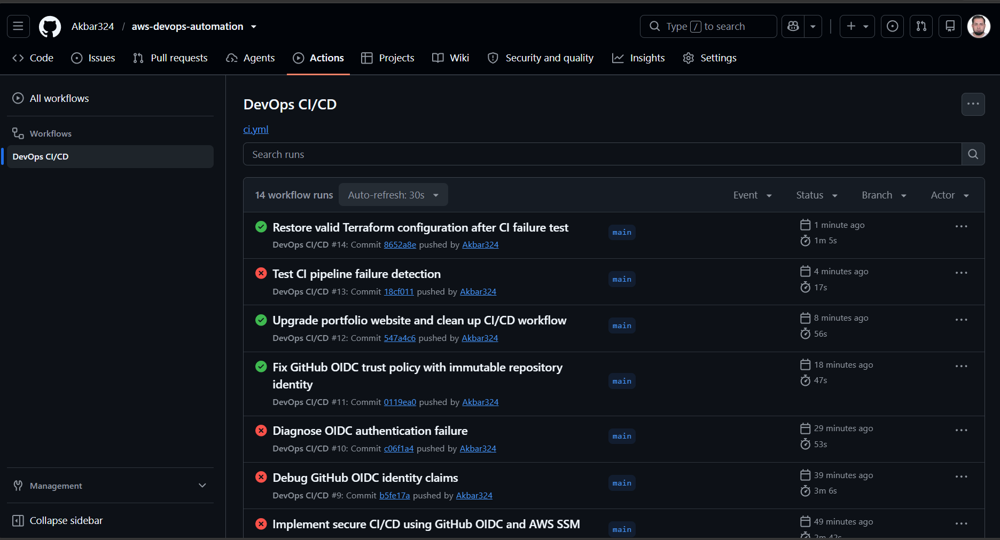

# AWS Infrastructure Automation & Secure CI/CD Pipeline


## Project Overview

A hands-on AWS DevOps portfolio project demonstrating infrastructure
provisioning, configuration management, containerization and secure
continuous integration and deployment.

The project uses Terraform to provision AWS infrastructure, Ansible
to configure an Ubuntu EC2 instance, Docker to host an Nginx web
application, and GitHub Actions to validate infrastructure code
and automatically deploy website updates.

GitHub Actions authenticates with AWS using OpenID Connect (OIDC),
eliminating the need for permanent AWS access keys in GitHub.

AWS Systems Manager Run Command enables remote deployments without
requiring inbound SSH access from GitHub-hosted runners.

## Application Preview



## Architecture



## Technology Stack

| Technology | Purpose |
|------------|---------|
| AWS EC2 | Application hosting |
| AWS IAM | Identity and access management |
| AWS STS | Temporary AWS credentials |
| AWS Systems Manager | Remote command execution |
| Terraform | Infrastructure as Code |
| Ansible | Configuration management |
| Docker | Application containerization |
| Nginx | Web server |
| GitHub Actions | CI/CD automation |
| Linux / Ubuntu | Server operating system |
| Bash | Automation scripting |
| Git and GitHub | Version control |

## Key Features

- Infrastructure provisioning using Terraform.
- Dynamic Ubuntu AMI discovery.
- AWS security group and SSH access configuration.
- Automated Ansible inventory generation.
- Idempotent server configuration using Ansible.
- Automated Docker installation and container deployment.
- Persistent website directory using a Docker bind mount.
- Container restart policy for service recovery.
- Automated Terraform and Ansible validation.
- Secure GitHub-to-AWS authentication using OIDC.
- Repository and branch-restricted IAM trust policy.
- Remote website deployment through AWS Systems Manager.
- HTTP response verification after deployment.
- CI failure detection and deployment blocking.

## Repository Structure

```text
aws-devops-automation/
├── .github/workflows/
│   └── ci.yml
├── terraform/
│   ├── provider.tf
│   ├── data.tf
│   ├── ec2.tf
│   ├── security_group.tf
│   ├── key_pair.tf
│   ├── variable.tf
│   ├── iam.tf
│   ├── github_oidc.tf
│   └── outputs.tf
├── ansible/
│   ├── nginx.yml
│   ├── docker.yml
│   ├── container.yml
│   ├── website.yml
│   └── deploy.yml
├── app/
│   └── index.html
├── scripts/
│   └── deploy-website.sh
├── docs/screenshots/
├── deploy.sh
├── update-inventory.sh
├── .gitignore
└── README.md
```

## Infrastructure Provisioning

Terraform provisions the following AWS resources:

- Ubuntu EC2 instance.
- EC2 security group.
- SSH key pair.
- IAM role and instance profile for Systems Manager.
- GitHub OIDC identity provider.
- IAM deployment role.
- IAM policy for SSM remote deployment.

The project uses an existing VPC and subnet.

## Configuration Management

Ansible runs from a local Ubuntu WSL control node.

The main deployment playbook executes:

1. Docker installation and service configuration.
2. Website directory creation.
3. Website file deployment.
4. Nginx container creation.
5. Container restart policy configuration.

The playbooks are designed to be idempotent.

The Nginx container exposes container port 80 through
EC2 host port 8080.

Website files are mounted into the container using a
read-only bind mount.

## CI/CD Pipeline

The pipeline is triggered by a push to the main branch.

### Continuous Integration

- Checkout repository.
- Initialize Terraform.
- Validate Terraform configuration.
- Install Ansible.
- Verify Docker collection availability.
- Perform Ansible playbook syntax validation.

### Continuous Deployment

The deployment job runs only after the CI job succeeds.

1. Authenticate with AWS using GitHub OIDC.
2. Obtain temporary AWS credentials.
3. Verify the assumed AWS identity.
4. Encode the website content for transport.
5. Execute an AWS SSM Run Command.
6. Update the website file on EC2.
7. Wait for the remote command to complete.
8. Verify the HTTP response from the Nginx container.

Website updates do not require rebuilding or restarting
the Nginx container.


## CI/CD Execution, Failure Detection and Recovery

The CI/CD pipeline was successfully tested through multiple
deployment scenarios:

- Successful GitHub OIDC authentication and AWS deployment.
- Automated website updates through AWS Systems Manager.
- Intentional Terraform validation failure.
- Deployment blocking when CI validation fails.
- Successful pipeline recovery after restoring valid configuration.

The following screenshot demonstrates successful deployments,
failure detection and recovery.



## Security Implementation

- No permanent AWS access keys stored in GitHub.
- Temporary credentials obtained through OIDC and STS.
- IAM trust policy restricted to the authorized repository
  identity and main branch.
- SSM SendCommand permissions scoped to the target EC2
  instance and AWS Run Shell Script document.
- SSH access restricted to an authorized IP address.
- No inbound SSH required for GitHub Actions deployments.
- Read-only website mount inside the Nginx container.
- Terraform state, local variables and private keys
  excluded from version control.

## Prerequisites

- AWS account.
- AWS CLI configured with appropriate permissions.
- Terraform installed on Windows.
- Ubuntu WSL with Ansible installed.
- Git and GitHub account.
- SSH key pair.
- Existing AWS VPC and public subnet.
- Internet connectivity for the EC2 instance and SSM Agent.

## Deployment Instructions

### 1. Clone the repository

```bash
git clone https://github.com/Akbar324/aws-devops-automation.git
cd aws-devops-automation
```

### 2. Configure Terraform

Update the AWS region and existing subnet configuration
as required for your AWS environment.

Create a local terraform/terraform.tfvars file:

```hcl
instance_type    = "t3.micro"
allowed_ssh_cidr = "YOUR_PUBLIC_IP/32"
ssh_public_key   = "YOUR_SSH_PUBLIC_KEY"
```

Update the GitHub OIDC trust policy to match the actual
OIDC subject of your repository and branch.

If an AWS GitHub OIDC provider already exists, reuse
or import it rather than creating a duplicate provider.

### 3. Provision AWS infrastructure

```bash
cd terraform
terraform init
terraform validate
terraform plan
terraform apply
```

### 4. Configure the server

From the project root in Ubuntu WSL:

```bash
ansible-galaxy collection install community.docker
bash deploy.sh
```

Update the SSH private key path in update-inventory.sh
to match your local environment.

The script reads the EC2 public IP from Terraform output,
generates the Ansible inventory and executes the
deployment playbook.

### 5. Configure GitHub repository variables

Navigate to:

Settings > Secrets and variables > Actions > Variables

Create the following repository variables:

| Variable | Value |
|----------|-------|
| AWS_ROLE_ARN | Terraform GitHub deployment role output |
| AWS_REGION | AWS deployment region |
| EC2_INSTANCE_ID | Terraform EC2 instance ID output |

### 6. Trigger continuous deployment

Update app/index.html and push the changes:

```bash
git add app/index.html
git commit -m "Update website"
git push
```

GitHub Actions validates the configuration and
automatically deploys the website update.

### 7. Verify the application

Open the following address from an authorized IP:

```text
http://EC2_PUBLIC_IP:8080
```

## Technical Challenges Resolved

### Terraform validation in GitHub Actions

A local SSH public key file was unavailable in the
GitHub-hosted runner.

The configuration was updated to use a Terraform input
variable, allowing CI validation without requiring
the local key file.

### Dynamic EC2 public IP

An automated inventory generation script was implemented
to retrieve the current public IP from Terraform state.

Terraform state must be refreshed after an external
EC2 stop/start operation.

### AWS Systems Manager connectivity

An EC2 IAM instance profile was configured with the
required Systems Manager permissions.

SSM connectivity and remote command execution were
verified before integrating continuous deployment.

### GitHub OIDC authentication

The initial IAM trust policy did not match the OIDC
subject generated by GitHub.

The issuer, audience and subject claims were inspected,
and the trust policy was updated to match the actual
repository identity while maintaining branch restrictions.

### CI quality gate

An intentional Terraform validation failure was used
to verify that unsuccessful CI execution prevents
the deployment job from running.

## Design Decisions

- Terraform handles infrastructure provisioning.
- Ansible handles initial server configuration.
- Docker provides a consistent application runtime.
- GitHub Actions handles CI validation and website deployment.
- AWS SSM removes the need for SSH-based CI/CD deployment.
- OIDC avoids permanent AWS credentials in GitHub.
- A Docker bind mount allows simple static website updates.

## Current Scope and Limitations

This is a single-instance DevOps portfolio project.

Infrastructure provisioning and initial Ansible
configuration are initiated locally.

The CI/CD workflow validates infrastructure code and
deploys static website updates. It does not automatically
apply Terraform changes or rebuild Docker images.

Terraform state is stored locally, and the application
uses HTTP rather than HTTPS.

## Future Enhancements

- Remote Terraform state using Amazon S3.
- Custom VPC and reusable Terraform modules.
- Pull request validation and branch protection.
- Docker image version pinning and vulnerability scanning.
- Custom Docker image builds and Amazon ECR.
- HTTPS using a domain and TLS certificate.
- Application monitoring with Prometheus and Grafana.
- Kubernetes and Helm-based deployments.
- Automated rollback and deployment strategies.

## Resource Cleanup

To avoid unnecessary AWS charges:

```bash
cd terraform
terraform plan -destroy
terraform destroy
```

Review shared IAM resources before destruction,
particularly the GitHub OIDC provider.

After infrastructure destruction, continuous deployment
will not work until the environment is recreated and
the GitHub repository variables are updated.

## Author

**Akbar Hussain**

AWS Certified Solutions Architect - Associate

Cloud & DevOps Engineering Portfolio

GitHub: https://github.com/Akbar324
